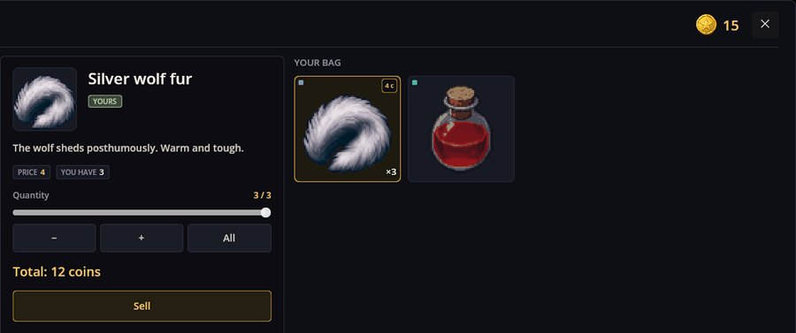
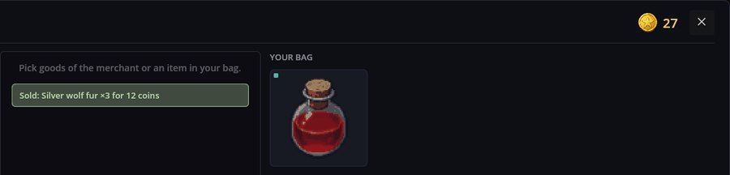

# Trading — 상인과 거래 창

Trading은 게임에 가게를 추가합니다. 가게는 데이터입니다: 상인이 무엇을 파는지, 무엇을 사들이는지, 얼마에 파는지. 가게를 여는 것은 시나리오이고, 플레이어는 두 인벤토리를 가진 창에서 거래합니다 — 왼쪽에는 상인의 물건, 오른쪽에는 플레이어의 가방이 있습니다. 돈은 평범한 아이템인 금화입니다: 가방에 들어 있고 가방과 함께 저장되며, 시나리오가 다른 아이템처럼 줄 수도 있습니다.

RPG Plus에서는 마을 상인이 이렇게 거래합니다: 말을 걸면 창이 열립니다.

## 사기

왼쪽에서 물건을 고르세요. 가운데에는 아이템, 가격, 내 지갑, **−**와 **+**, **전부**가 달린 수량 슬라이더, 그리고 합계가 나옵니다. **사기**로 거래가 끝납니다:


영웅은 동전 25 닢을 들고 왔고, 엘릭서에 10 닢을 썼으니 지갑에는 15 닢이 남고 엘릭서는 가방에 들어갑니다. 슬라이더는 돈이 닿는 곳까지만 갑니다 — 지금은 1까지.

## 팔기

가방에서 아이템을 고르세요. 상인이 사들이는 아이템에는 가격표가 붙고, 나머지는 여기서 팔 수 없습니다. **전부**는 수량을 가진 만큼으로 맞춥니다:





15 + 3 × 4 = **27** 닢. Esc나 ×로 창을 닫습니다.

상인의 재고는 줄지 않고, 판 물건이 다시 나오지도 않습니다: 가게에는 자기 상태가 없고, 바뀌는 것은 내 가방뿐입니다.

## 데이터로서의 가게

가게는 `shop` 종류의 엔티티로 mod의 `shops/` 폴더에 들어갑니다. 마을 상인을 RPG Demo는 이렇게 정의합니다:

```json
{
  "Kind": "shop",
  "Items": [
    {
      "Id": "rpg_demo/village_merchant",
      "Name": "rpg_demo/shop/village_merchant",
      "Sells": [ { "Item": "rpg_demo/elixir", "Price": 10 } ],
      "Buys": [
        { "Item": "rpg_demo/branches", "Price": 1 },
        { "Item": "rpg_demo/stones", "Price": 2 }
      ]
    }
  ]
}
```

- `Name` — 창 제목의 번역 키.
- `Sells` — 플레이어가 살 수 있는 물건. 이 순서대로, 하나 가격과 함께.
- `Buys` — 상인이 값을 주는 것. 나머지는 거절합니다.
- `Currency`(선택) — 돈 아이템. 기본값은 이 mod의 금화 `money/coin`.
- 1 미만의 가격은 무시됩니다: 공짜 아이템은 선물이고, 선물은 시나리오의 일입니다.

RPG Plus는 RPG Demo의 파일을 건드리지 않고, 자기 `patches/shop.json`의 패치로 같은 상인에게 장비와 물건을 추가합니다:

```json
{ "Items": [ { "Id": "rpg_demo/village_merchant",
  "Sells$add": [ { "Item": "classic/iron_sword", "Price": 30 } ],
  "Buys$add": [ { "Item": "rpg_plus/wolf_pelt", "Price": 4 } ] } ] }
```

## 가게 열기

```scenario
text "오, 손님이다! 엘릭서 신선해요, 앙금도 거의 없어요." key=rpg_demo/merchant/line1
action trade.open shop=rpg_demo/village_merchant
end
```

상인의 맵 이벤트가 이 시나리오를 실행합니다. 어떤 시나리오든 같은 방식으로 가게를 열 수 있습니다 — 대화 선택지로, 인터랙티브 오브젝트 클릭으로.

## 문제가 생겼을 때

1. **가방의 아이템이 팔리지 않습니다.** 가게의 `Buys`에 없습니다.
2. **사기가 아무것도 하지 않습니다.** 한 개 살 돈도 부족합니다. 창이 그렇게 말해 줍니다.
3. **창이 열리지 않습니다.** `shop=`의 id가 어느 가게의 `Id`와도 일치하지 않습니다. 로그가 이름을 알려 줍니다.
