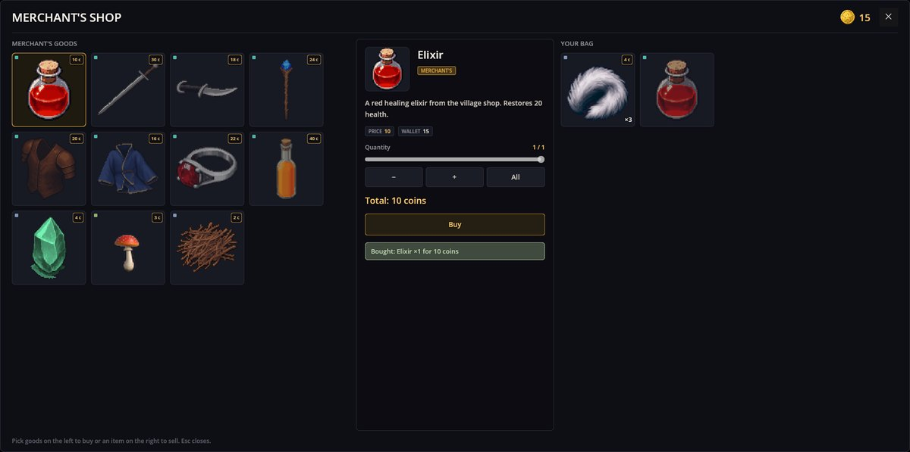

# Trading——商人与交易窗口

Trading 给游戏添加商店。商店就是数据：商人卖什么、回收什么、价格多少。打开商店的是一个剧本，玩家在一个有两个背包的窗口里交易——左边是商人的货物，右边是玩家的背包。钱是一种普通物品——金币：它放在背包里、随背包一起存档，也能像其他物品一样由剧本发给你。

在 RPG Plus 里，村里的商人就是这样做买卖的：和他对话，窗口就会打开。

## 购买

在左边挑货物。中间显示物品、价格、你的钱包、带 **−**、**+** 和 **全部** 的数量滑块，以及合计。**购买**完成交易：



英雄来时带着 25 枚金币；药剂花了 10 枚，所以钱包显示 15，药剂进了背包。滑块最多只能拉到钱够用的位置——现在是 1。

## 出售

在背包里选中一件物品。商人回收的物品带价签；其他的在这里卖不掉。**全部**把数量设为你拥有的全部：


15 + 3 × 4 = **27** 枚金币。Esc 或叉号关闭窗口。

商人的货源永远不枯竭，卖出去的东西也不会再被摆出来：商店自己没有状态，变化的只有你的背包。

## 数据形式的商店

商店是 `shop` 类型的实体，放在 mod 的 `shops/` 文件夹里。村商人由 RPG Demo 这样定义：

```json
{
  "Kind": "shop",
  "Items": [
    {
      "Id": "rpg_demo/village_merchant",
      "Name": "rpg_demo/shop/village_merchant",
      "Sells": [ { "Item": "rpg_demo/elixir", "Price": 10 } ],
      "Buys": [
        { "Item": "rpg_demo/branches", "Price": 1 },
        { "Item": "rpg_demo/stones", "Price": 2 }
      ]
    }
  ]
}
```

- `Name`——窗口标题的翻译键。
- `Sells`——玩家能买的东西，按此顺序排列，价格是一份的价钱。
- `Buys`——商人付钱回收的东西；其余一概不收。
- `Currency`（可选）——货币物品；默认是 `money/coin`，本 mod 的金币。
- 低于 1 的价格会被忽略：免费的物品是礼物，而礼物属于剧本。

RPG Plus 用自己 `patches/shop.json` 里的补丁，把它的装备和货物加到同一个商人身上，不去动 RPG Demo 的文件：

```json
{ "Items": [ { "Id": "rpg_demo/village_merchant",
  "Sells$add": [ { "Item": "classic/iron_sword", "Price": 30 } ],
  "Buys$add": [ { "Item": "rpg_plus/wolf_pelt", "Price": 4 } ] } ] }
```

## 打开商店

```scenario
text "哦，来客人了！药剂新鲜，几乎没有沉淀。" key=rpg_demo/merchant/line1
action trade.open shop=rpg_demo/village_merchant
end
```

商人的地图事件运行这个剧本。任何剧本都能这样打开商店——一个对话选项、一次对互动物体的点击。

## 出问题了？

1. **背包里的物品卖不掉。** 它不在商店的 `Buys` 里。
2. **购买没有反应。** 金币连买一份都不够；窗口会这么说。
3. **窗口打不开。** `shop=` 的 id 和任何商店的 `Id` 都对不上；日志里会写明。
